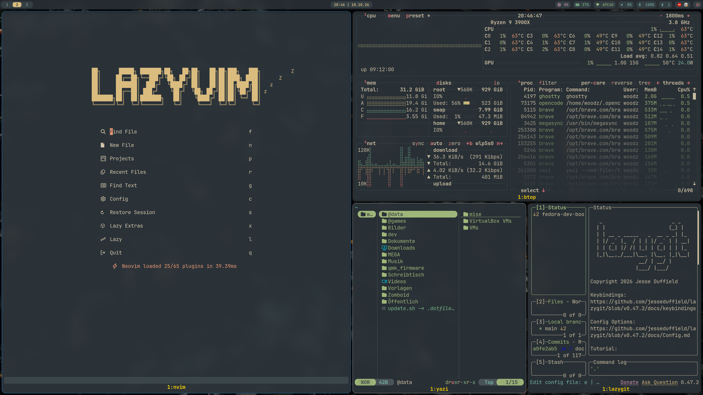
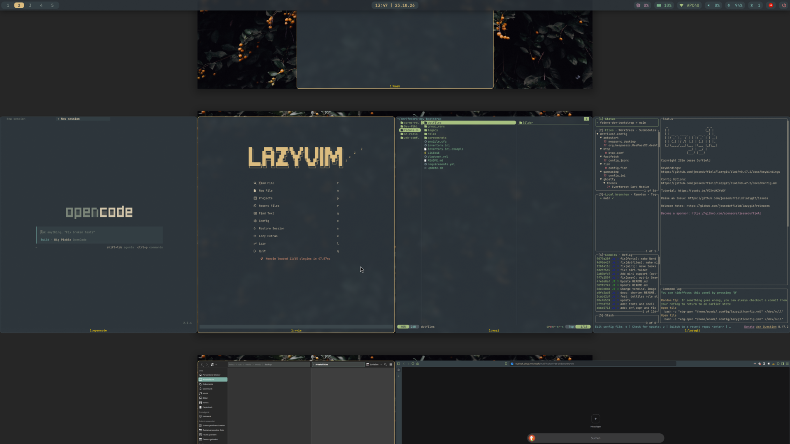

# FedDev

[](https://getfedora.org/)
[](https://www.ansible.com/)
[](LICENSE)

**English** · [Deutsch](#deutsch)

A fully automated Fedora developer bootstrap built on **Ansible** – designed for a
one-shot run on a fresh Fedora installation.

System setup, packages, fonts, Flatpak apps, mise runtimes and **GNU Stow**-deployed
**dotfiles** (Fish, Neovim/LazyVim, tmux, Yazi, Kitty/Ghostty, Sway, niri and more).

## Screenshots

swayfx:

niri:


## Desktop: Sway/SwayFX or niri

Pick your Wayland desktop – or install both and choose at the login screen.
Both compositors are toggled in [`group_vars/fedora.yml`](group_vars/fedora.yml)
(or per host in `inventory.ini`):

| `install_swayfx` | `install_niri` | Result                                                 |
| :--------------: | :------------: | ------------------------------------------------------ |
|      `true`      |    `false`     | SwayFX only – replaces a preinstalled `sway`           |
|     `false`      |     `true`     | niri only                                              |
|      `true`      |     `true`     | both – pick **sway** or **niri** in greetd _(default)_ |
|     `false`      |    `false`     | no compositor – packages and dotfiles only             |

```ini
[fedora:vars]
install_swayfx=true   # SwayFX from COPR
install_niri=true     # niri from Fedora
```

Matching dotfiles are stowed automatically: [`dotfiles/.config/sway/`](dotfiles/.config/sway/)
for SwayFX and [`dotfiles/.config/niri/`](dotfiles/.config/niri/) for niri.

## Installation

Requires Fedora Linux (Workstation or Sway Spin), tested on **Fedora 44**.

```bash
sudo dnf install -y ansible-core git
git clone https://github.com/JeromeTDev/fedora-dev-bootstrap.git
cd fedora-dev-bootstrap
ansible-galaxy collection install -r requirements.yml # once: copr + flatpak
ansible-playbook playbook.yml -K
```

Without an `inventory.ini`, the machine you start the playbook on is the target.
For a different machine: copy `inventory.ini.example` to `inventory.ini` and define
a group named `fedora` with `ansible_host`/`ansible_user` – the file is picked up
automatically via `ansible.cfg` and is listed in `.gitignore`.

## Tools

Everything configurable lives in [`group_vars/fedora.yml`](group_vars/fedora.yml).

| Category           | Source               | Tools                                                                                                           |
| ------------------ | -------------------- | --------------------------------------------------------------------------------------------------------------- |
| Dev & Build        | Fedora               | `git`, `gh`, `make`, `gcc`, `luarocks`, `texlive-scheme-medium`                                                 |
| Shell & Editor     | Fedora               | `fish` (default shell), `neovim` (LazyVim), `tmux`                                                              |
| CLI                | Fedora               | `fzf`, `zoxide`, `btop`, `tree`, `ripgrep`, `fd-find`, `jq`, `ncdu`, `stow`, `fastfetch`                        |
| Media & PDF        | Fedora               | `ImageMagick`, `mediainfo`, `perl-Image-ExifTool`, `poppler-utils`, `zathura`, `zathura-pdf-mupdf`              |
| Desktop            | Fedora               | `dolphin`, `gammastep`, `xournalpp`, `wl-clipboard`, `keepassxc`                                                |
| Prompt & Terminals | COPR                 | `starship`, `lazygit`, `yazi`, `ghostty`                                                                        |
| Window Manager     | Fedora/COPR – opt-in | `rofi`, `mako`, **SwayFX** or **niri** (choose either, both or none)                                            |
| Apps               | Flatpak, system-wide | Discord, Obsidian, Cryptomator, TeamSpeak, ONLYOFFICE, Telegram, Signal                                         |
| Fonts              | GitHub release       | JetBrainsMono Nerd Font → `~/.local/share/fonts`                                                                |
| Runtimes           | mise                 | `python`, `rust`, `uv`, `opencode`                                                                              |
| System             | DNF                  | `fastestmirror`, 15 parallel downloads, `defaultyes`, no weak deps, `clean_requirements_on_remove`, `plugins=1` |

A full `dnf upgrade` runs on top of that. Runtimes come from
[`dotfiles/.config/mise/config.toml`](dotfiles/.config/mise/config.toml), falling
back to `mise_tools` in `group_vars/fedora.yml`.

## Dotfiles

`dotfiles/` is copied to `~/.dotfiles` on the first run and stowed from there
(`dotfiles/ -> ~/.dotfiles --stow .--> ~/.config/...`).

- An existing `~/.dotfiles` always wins – move your own dotfiles there beforehand
- If `dotfiles/` is absent, nothing is stowed
- Every top-level entry is linked individually; a real directory such as `~/.config`
  is **not** replaced, but merged into it via `--adopt`
- Paths are overridable in [`roles/dotfiles/defaults/main.yml`](roles/dotfiles/defaults/main.yml)
  (`dotfiles_dir`, `dotfiles_src`, `dotfiles_stow_target`)

> **Careful:** `--adopt` takes over existing files (e.g. a `~/.config/fontconfig/fonts.conf`
> created by the desktop) – back them up first if needed. Never run `stow .` on the
> **repo root**, or `roles/` and `playbook.yml` end up in your home directory.

**tmux plugins** are managed by `TPM` and will be installed automatically on first launch of tmux (via `run '~/.tmux/plugins/tpm/tpm'` in the config). If needed, they can also be installed with `Prefix + I`.

## Updates

[`update.sh`](update.sh) updates DNF, mise and Flatpak in one go: `./update.sh`

Legacy bash script with a Btrfs/Snapper strategy: [`legacy/feddev-setup.sh`](legacy/feddev-setup.sh)
– kept as a historical reference, no longer maintained.

## License

MIT License – (c) JeromeTDev

---

# Deutsch

Ein **vollautomatischer Fedora-Developer-Bootstrap** auf **Ansible**-Basis –
gedacht für die **einmalige** Ausführung auf einer frischen Fedora-Installation.

System-Setup, Pakete, Schriften, Flatpak-Apps, mise-Runtimes und per **GNU Stow**
deployte **Dotfiles** (Fish, Neovim/LazyVim, tmux, Yazi, Kitty/Ghostty, Sway/niri u. v. m.).

## Desktop: Sway/SwayFX oder niri

Wayland-Desktop auswählen – oder beide installieren und erst beim Login entscheiden.
Beide Compositor werden in [`group_vars/fedora.yml`](group_vars/fedora.yml)
(oder pro Host in `inventory.ini`) geschaltet:

| `install_swayfx` | `install_niri` | Ergebnis                                                           |
| :--------------: | :------------: | ------------------------------------------------------------------ |
|      `true`      |    `false`     | nur SwayFX – ersetzt ein vorhandenes `sway`                        |
|     `false`      |     `true`     | nur niri                                                           |
|      `true`      |     `true`     | beide – im greetd-Login **sway** oder **niri** wählen _(Standard)_ |
|     `false`      |    `false`     | kein Compositor – nur Pakete und Dotfiles                          |

```ini
[fedora:vars]
install_swayfx=true   # SwayFX aus COPR
install_niri=true     # niri aus Fedora
```

Passende Dotfiles werden automatisch gestowt: [`dotfiles/.config/sway/`](dotfiles/.config/sway/)
für SwayFX und [`dotfiles/.config/niri/`](dotfiles/.config/niri/) für niri.

## Installation

Voraussetzung: Fedora Linux (Workstation oder Sway Spin), getestet auf **Fedora 44**.

```bash
sudo dnf install -y ansible-core git
git clone https://github.com/JeromeTDev/fedora-dev-bootstrap.git
cd fedora-dev-bootstrap
ansible-galaxy collection install -r requirements.yml # einmalig: copr + flatpak
ansible-playbook playbook.yml -K
```

Ohne `inventory.ini` ist der Rechner, auf dem du das Playbook startest, das Ziel.
Für eine andere Maschine: `cp inventory.ini.example inventory.ini` und dort eine
Gruppe `fedora` mit `ansible_host`/`ansible_user` eintragen – die Datei wird über
`ansible.cfg` automatisch erkannt und ist in `.gitignore`.

## Tools

Alles Anpassbare liegt in [`group_vars/fedora.yml`](group_vars/fedora.yml).

| Kategorie          | Quelle               | Tools                                                                                                             |
| ------------------ | -------------------- | ----------------------------------------------------------------------------------------------------------------- |
| Dev & Build        | Fedora               | `git`, `gh`, `make`, `gcc`, `luarocks`, `texlive-scheme-medium`                                                   |
| Shell & Editor     | Fedora               | `fish` (Default-Shell), `neovim` (LazyVim), `tmux`                                                                |
| CLI                | Fedora               | `fzf`, `zoxide`, `btop`, `tree`, `ripgrep`, `fd-find`, `jq`, `ncdu`, `stow`, `fastfetch`                          |
| Medien & PDF       | Fedora               | `ImageMagick`, `mediainfo`, `perl-Image-ExifTool`, `poppler-utils`, `zathura`, `zathura-pdf-mupdf`                |
| Desktop            | Fedora               | `dolphin`, `gammastep`, `xournalpp`, `wl-clipboard`, `keepassxc`                                                  |
| Prompt & Terminals | COPR                 | `starship`, `lazygit`, `yazi`, `ghostty`                                                                          |
| Window Manager     | Fedora/COPR – opt-in | `rofi`, `mako`, **SwayFX** oder **niri** (einzeln, beide oder keins)                                              |
| Apps               | Flatpak, systemweit  | Discord, Obsidian, Cryptomator, TeamSpeak, ONLYOFFICE, Telegram, Signal                                           |
| Schriften          | GitHub-Release       | JetBrainsMono Nerd Font → `~/.local/share/fonts`                                                                  |
| Runtimes           | mise                 | `python`, `rust`, `uv`, `opencode`                                                                                |
| System             | DNF                  | `fastestmirror`, 15 Paralleldownloads, `defaultyes`, keine weak-deps, `clean_requirements_on_remove`, `plugins=1` |

Zusätzlich läuft ein `dnf upgrade`. Runtimes kommen aus
[`dotfiles/.config/mise/config.toml`](dotfiles/.config/mise/config.toml), sonst aus
`mise_tools` in `group_vars/fedora.yml`.

## Dotfiles

`dotfiles/` wird beim ersten Lauf nach `~/.dotfiles` kopiert und von dort per Stow
verlinkt (`dotfiles/ -> ~/.dotfiles --stow .--> ~/.config/...`).

- Ein vorhandenes `~/.dotfiles` gewinnt immer – eigene Dotfiles vorher dorthin ziehen
- Fehlt `dotfiles/`, wird nichts gestowt
- Jeder Top-Level-Eintrag wird einzeln verlinkt; ein echtes Verzeichnis wie `~/.config`
  wird **nicht** ersetzt, sondern mit `--adopt` hineingemischt
- Pfade überschreibbar in [`roles/dotfiles/defaults/main.yml`](roles/dotfiles/defaults/main.yml)
  (`dotfiles_dir`, `dotfiles_src`, `dotfiles_stow_target`)

> **Achtung:** `--adopt` übernimmt vorhandene Dateien (z. B. eine vom Desktop angelegte
> `~/.config/fontconfig/fonts.conf`) – vorher ggf. sichern. `stow .` niemals auf das
> **Repo-Root** anwenden, sonst landen `roles/` und `playbook.yml` in deinem Home.

**tmux-Plugins** werden von `TPM` verwaltet und beim ersten Start von tmux automatisch installiert (über `run '~/.tmux/plugins/tpm/tpm'` in der Konfiguration). Falls nötig, können sie auch mit `Prefix + I` installiert werden.

## Updates

[`update.sh`](update.sh) aktualisiert DNF, mise und Flatpak in einem Durchgang: `./update.sh`

Altes Bash-Script mit Btrfs-/Snapper-Strategie: [`legacy/feddev-setup.sh`](legacy/feddev-setup.sh)
– historische Referenz, nicht mehr gepflegt.

## License

MIT License – (c) JeromeTDev
