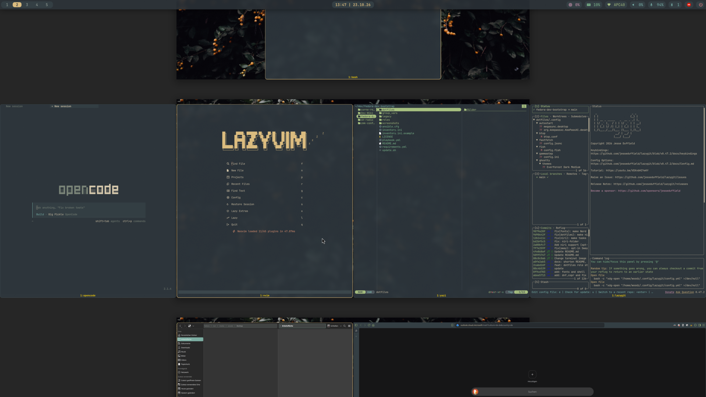

# FedDev

[](https://getfedora.org/)
[](https://www.ansible.com/)
[](LICENSE)

**English** · [Deutsch](#deutsch)

One-shot Fedora 44 developer workstation bootstrap with Ansible: **niri**,
greetd/tuigreet, fish, Neovim, tmux, Ghostty, Flatpak apps, Nerd Font and
GNU Stow managed dotfiles.



## Install

Fedora Minimal or Workstation (tested on **Fedora 44**, compatible with **Fedora 45**). Run as a normal user;
`-K` asks for the sudo password.

```bash
sudo dnf install -y ansible-core git
git clone https://github.com/JeromeTDev/fedora-dev-bootstrap.git
cd fedora-dev-bootstrap
ansible-galaxy collection install -r requirements.yml
ansible-playbook playbook.yml -K
sudo reboot
```

`ansible-core` and `git` are the only prerequisites; the `bootstrap` role
installs the required DNF Python bindings on the target.

Without `inventory.ini` the local machine is configured. For another machine:
`cp inventory.ini.example inventory.ini` and fill in `ansible_host` and
`ansible_user`.

## Display manager

Selected in [`group_vars/fedora.yml`](group_vars/fedora.yml):

```yaml
display_manager: greetd   # greetd | none
```

- `greetd` (default): greetd + tuigreet on TTY1; other display managers are disabled.
- `none`: keep an existing greeter (e.g. GDM) and select **niri** at its login
  screen. A greeter enabled by an earlier run is not disabled automatically.

The change takes effect after a reboot. Running sessions are not terminated.

## Tools

| Area            | Included                                                                                                                                                                                                 |
| --------------- | -------------------------------------------------------------------------------------------------------------------------------------------------------------------------------------------------------- |
| Dev & build     | `git`, `gh`, `make`, `gcc`, `luarocks`, `texlive-scheme-medium`                                                                                                                                          |
| Shell & editor  | `fish` (default shell), `neovim` (LazyVim), `tmux`                                                                                                                                                      |
| CLI             | `fzf`, `zoxide`, `btop`, `tree`, `ripgrep`, `fd-find`, `jq`, `ncdu`, `stow`, `fastfetch`                                                                                                                |
| Media & PDF     | `ImageMagick`, `mediainfo`, `perl-Image-ExifTool`, `poppler-utils`, `zathura`, `zathura-pdf-mupdf`                                                                                                      |
| Desktop         | `niri`, `xwayland-satellite`, Waybar, rofi, mako, swaybg, swayidle, swaylock, `lxqt-policykit`, `gnome-keyring`, XDG portals, `grim`, `slurp`, `wl-clipboard`, `playerctl`, `brightnessctl`, `dolphin`, `gammastep`, `xournalpp`, `keepassxc` |
| Login           | `greetd` + `tuigreet` on TTY1 (or `none` to keep an existing greeter)                                                                                                                                     |
| COPR            | `starship`, `lazygit`, `yazi`, `ghostty`                                                                                                                                                                |
| Flatpak         | Discord, Obsidian, Cryptomator, TeamSpeak, ONLYOFFICE, Telegram, Signal                                                                                                                                 |
| Fonts           | JetBrainsMono Nerd Font → `~/.local/share/fonts`                                                                                                                                                         |
| Runtimes        | `python`, `rust`, `node`, `uv`, `opencode` (mise)                                                                                                                                                        |
| System          | DNF tuning, full upgrade, NetworkManager, PipeWire, BlueZ, UPower, `power-profiles-daemon`                                                                                                               |

## Customize

Packages, Flatpak apps, fonts, mise tools and the display manager live in
[`group_vars/fedora.yml`](group_vars/fedora.yml). The niri config is
[`dotfiles/.config/niri/config.kdl`](dotfiles/.config/niri/config.kdl).

## Dotfiles

`dotfiles/` is copied to `~/.dotfiles` on the first run and linked into `$HOME`
with GNU Stow. An existing `~/.dotfiles` always wins and is left untouched.

- Existing files are merged with `--adopt`; back up anything you want to keep.
- The included configs are a public-safe subset: wallpaper only, no private state.
- `gammastep` ships with Berlin coordinates; adjust them for your location.
- The niri outputs and workspace pinning are tuned to the author's monitor setup.
- Paths are overridable in [`roles/dotfiles/defaults/main.yml`](roles/dotfiles/defaults/main.yml).

## Update

```bash
./update.sh
```

## License

MIT License – (c) JeromeTDev

---

# Deutsch

Einmaliger Fedora-44-Developer-Bootstrap mit Ansible: **niri**,
greetd/tuigreet, fish, Neovim, tmux, Ghostty, Flatpak-Apps, Nerd Font und per
GNU Stow verwaltete Dotfiles.

## Installation

Fedora Minimal oder Workstation (getestet auf **Fedora 44**, kompatibel mit
**Fedora 45**). Als normaler Benutzer ausführen; `-K` fragt nach dem
sudo-Passwort.

```bash
sudo dnf install -y ansible-core git
git clone https://github.com/JeromeTDev/fedora-dev-bootstrap.git
cd fedora-dev-bootstrap
ansible-galaxy collection install -r requirements.yml
ansible-playbook playbook.yml -K
sudo reboot
```

`ansible-core` und `git` sind die einzigen Voraussetzungen; die Rolle
`bootstrap` installiert die nötigen DNF-Python-Bindings auf dem Zielhost.

Ohne `inventory.ini` wird der lokale Rechner konfiguriert. Für eine andere
Maschine: `cp inventory.ini.example inventory.ini` und `ansible_host` sowie
`ansible_user` eintragen.

## Display-Manager

Auswahl in [`group_vars/fedora.yml`](group_vars/fedora.yml):

```yaml
display_manager: greetd   # greetd | none
```

- `greetd` (Default): greetd + tuigreet auf TTY1; andere Display-Manager werden
  deaktiviert.
- `none`: einen vorhandenen Greeter behalten (z. B. GDM) und beim Login **niri**
  auswählen. Ein von einem früheren Lauf aktivierter Greeter wird nicht
  automatisch deaktiviert.

Die Änderung greift nach einem Reboot. Laufende Sitzungen werden nicht beendet.

## Werkzeuge

Die Tool-Übersicht steht oben unter [Tools](#tools).

## Anpassen

Pakete, Flatpak-Apps, Schriften, mise-Tools und der Display-Manager stehen in
[`group_vars/fedora.yml`](group_vars/fedora.yml). Die niri-Config liegt in
[`dotfiles/.config/niri/config.kdl`](dotfiles/.config/niri/config.kdl).

## Dotfiles

`dotfiles/` wird beim ersten Lauf nach `~/.dotfiles` kopiert und per GNU Stow
nach `$HOME` verlinkt. Ein vorhandenes `~/.dotfiles` gewinnt immer und bleibt
unangetastet.

- Vorhandene Dateien werden per `--adopt` zusammengeführt; was erhalten bleiben
  soll, vorher sichern.
- Die enthaltenen Configs sind eine public-safe Teilmenge: nur das Wallpaper,
  kein privater State.
- `gammastep` enthält Berlin-Koordinaten; für den eigenen Standort anpassen.
- Die niri-Ausgänge und das Workspace-Pinning sind auf das Monitor-Setup des
  Autors abgestimmt.
- Pfade überschreibbar in [`roles/dotfiles/defaults/main.yml`](roles/dotfiles/defaults/main.yml).

## Update

```bash
./update.sh
```

## License

MIT License – (c) JeromeTDev
